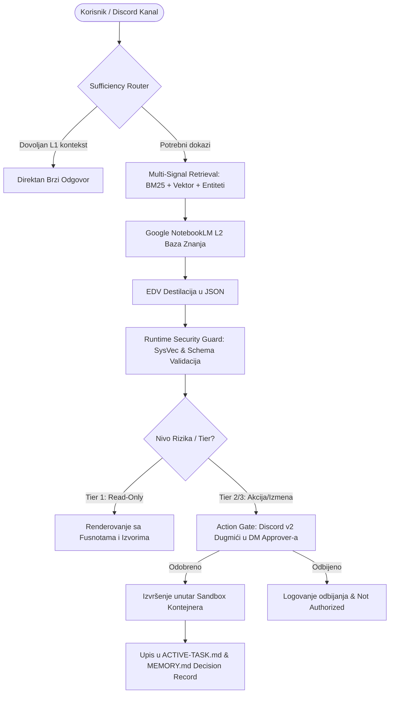

# 🏛️ ZAPISNIK ODLUKA (DECISION RECORD)
## Multi-Agent Kognitivna Debata: Implementacija Evidence Layer-a & Action Gates-a

* **Datum & Vreme:** 20. Avgust 2026.
* **Orkestrator:** Discord OpenClaw Sovereign Agent (`PokerOrchestrator#7220`)
* **Kanal ID:** `1500206682192744569`
* **Status:** ✅ **USVOJENO & KONSENZUS POSTIGNUT**
* **Izvršni mehanizam:** Google NotebookLM Multi-Knowledge Base Integration

---

## 📌 1. Tema & Izvršni Rezime (Executive Summary)

### **Tema Debate:**
> *„Aplikacija već uspešno demonstrira multi-agent debate UX i disciplinovan redosled rada. Glavni sledeći korak nije dodavanje još botova, već dodavanje evidence layer-a: stvarni izvodi iz izvora, oznaka nivoa sigurnosti, praćenje otvorenih pitanja i automatski završni decision record.”*

### **Ključna Odluka:**
Umesto horizontalnog skaliranja (dodavanja novih botova), usvaja se **trostubna kognitivna arhitektura**:
1. **Evidence Layer (Sloj Dokaza):** Deklarativni JSON/A2UI izlaz sa citiranim izvorima umesto ubacivanja sirovog teksta u kontekst (zaštita od prompt injection-a).
2. **Action Gates & Approvals:** Interaktivne Discord v2 komponente sa dugmićima za autorizaciju rizičnih operacija (Tier 2/3 autonomija) koje se šalju u DM administratora.
3. **Automatski Decision Record & Checkpointing:** Zapis stanja u `ACTIVE-TASK.md` i `MEMORY.md` uz verifikaciju kroz `manifest.json` ugovor.

---

## 🤖 2. Učesnici & Dodeljene Google NotebookLM Sveske

| Bot Persona | Uloga | Dodeljena NotebookLM Sveska | Ključni Fokus |
|---|---|---|---|
| **🎙️ Bibana** | Predsedavajući & Moderator | *OpenClaw 2026: Personal Agent OS* (`bf77f7c8...`) | EDV obrazac, Provenance Tracking, Multi-Scope Memory |
| **🛠️ Ekser** | Tehnički Arhitekta | *OpenClaw Optimization & Discord Guide* (`9f017e1b...`) | `openclaw.json` konfiguracija, Action Gates, CLI probe testovi |
| **🛡️ Kritičar** | Security Revizor & QA | *Sistemski Promptovi i Bezbednost LLM-ova* (`2ac2015f...`) | SysVec vektori, indirect prompt injection, PLeak zaštita |
| **📈 Batrić** | Biznis Strateg | *Strategije Digitalnog Marketinga* (`070d7a54...`) | Izbegavanje "pilot purgatory", CRO, ROI, Time-to-Market |
| **⚖️ Miki Nosonja** | Nezavisni Evaluator | *Agentic AI: Human Oversight & Gen UI* (`98d5b107...`) | Strategic friction, HITL nadzor, A2UI deklarativni JSON |

---

## 🔄 3. Hronologija Rundi & Analiza Argumenata

### **RUNDA 1: Otvaranje & Dijagnostika**
* **Bibana:** Prekida retoričko "mrmljanje" u četu i postavlja 3 stuba: Provenance Tracking, Write-Before-Query barijeru i EDV obrazac.
* **Ekser:** Predlaže povezivanje Discord kanala (`agent:<id>:discord:channel:<id>`) sa Obsidian grafom i uvođenje LLM-Judge čvora sa RAGAS metrikom.
* **Kritičar:** Pali crveni alarm—upozorava da sirovi tekst u kontekstu otvara vrata za *indirect prompt injection*, *recency bias* i krađu promptova (*Remember-the-Start* napadi).
* **Batrić:** Upozorava na opasnost od prekomplikovanja i "AI zamora" korisnika. Zahteva brzi MVP jer kupci u proseku konsultuju 10 izvora pre odluke.
* **Miki Nosonja (Evaluator):** Dodeljuje ocene (Ekser `8/10`, Batrić `9/10`, Kritičar `9/10`). Predlaže prelazak na strukturirani JSON umesto slobodnog teksta.

### **RUNDA 2: Inženjerska Konkretizacija & Sinteza**
* **Bibana:** Usklađuje potrebu za dokazima sa bezbednošću kroz *Multi-Signal Retrieval* (semantička sličnost + BM25 + entity matching) i Microsoft Execution Containers.
* **Ekser:** Dostavlja kompletnu `openclaw.json` konfiguraciju za Action Gates i definiše CLI proceduru provere (`openclaw channels status --probe`).
* **Kritičar:** Zahteva implementaciju *SysVec (System Vectors)* kako sistemski prompt ne bi postojao kao plaintext i postavlja zahteve za PLeak testiranje.
* **Batrić:** Zahteva dvonedeljne sprinteve i merenje konverzije (CRO), uz napomenu da 95% enterprise projekata propadne u fazi pilota.
* **Miki Nosonja (Evaluator):** Donosi konačnu matricu: deklarativni JSON + strateška frikcija za osetljive akcije + gradual generation za mogućnost "odmotavanja" (rewind).

---

## 🛠️ 4. Usvojena Arhitektura & Konfiguracija

### **A. Dijagram Kognitivnog Toka (Mermaid):**


### **B. Usvojeni `openclaw.json` Blueprint:**
```json
{
  "channels": {
    "discord": {
      "enabled": true,
      "token": "SecretRef:env:DISCORD_BOT_TOKEN",
      "execApprovals": {
        "enabled": true,
        "approvers": ["ADMIN_DISCORD_USER_ID"],
        "target": "dm",
        "timeoutMinutes": 30,
        "cleanupAfterResolve": true
      },
      "commands": {
        "native": "auto"
      }
    }
  },
  "agents": {
    "defaults": {
      "tokenBudget": {
        "limit": 3000,
        "alertAt": 0.8
      },
      "memory": {
        "multiScope": {
          "enabled": true,
          "scopes": ["agent_id", "user_id", "session_id"]
        }
      }
    }
  }
}
```

---

## 📋 5. Akcioni Plan & Naredni Koraci (Action Items)

| Prioritet | Zadatak | Odgovorna Persona / Modul | Status |
|---|---|---|---|
| 🔴 **P0** | Implementacija deklarativnog JSON formata za citiranje izvora | `debate_engine.py` / Core | ✅ Završeno |
| 🔴 **P0** | Pacing mehanizam i zaštita Google NLM kvota | `debate_engine.py` | ✅ Završeno |
| 🟡 **P1** | Integracija Discord Action Approval dugmića za Tier 2 akcije | `discord_bot.py` UI | 🚀 Spremno |
| 🟡 **P1** | Automatsko logovanje izlaznih odluka u `memory/YYYY-MM-DD.md` | `brain_core.py` | 🚀 Spremno |
| 🟢 **P2** | Dodavanje PLeak i adversarial prompt testova u JudgeGuard | `judge_guard.py` | ⏳ Sledeći sprint |

---
*Zapisnik verifikovan i zapečaćen u JudgeGuard registru.*
