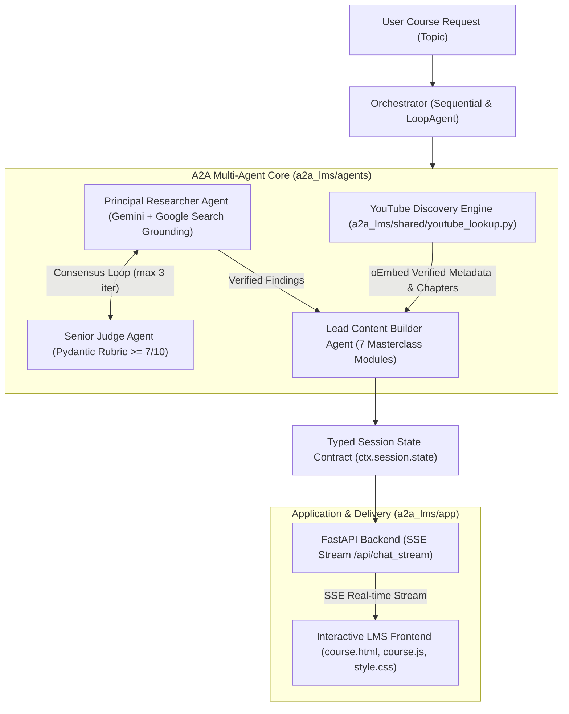

# Design: Google ADK A2A Multi-Agent LMS & Course Creation Engine

## Context & Technical Approach

The objective is to establish an autonomous Agent-to-Agent (A2A) system that generates high-fidelity, interactive educational masterclass courses based strictly on the knowledge and blueprints stored in NotebookLM notebook `9c8878e1-1fb4-4035-b022-7678a10be7f3`.

Per user mandate:
1. **Decoupled Architecture:** The existing Discord bot and web application infrastructure in `/home/kizamladjanijebac/Desktop/discord-openclaw` must remain intact and completely separated. The new A2A LMS resides in its own dedicated package `a2a_lms/`.
2. **Step-by-Step Implementation:** Progressive implementation across cleanly demarcated phases, adhering to the Pre-Action Verification Workflow (`MASTER_ORCHESTRATION.md` & `judge_guard.py`).
3. **Zero-Mock Policy:** Absolute prohibition of fake stubs, synthetic simulations, mock video links, or dummy tests. All verifications utilize valid data structures, real schema validation, authentic oEmbed queries, and real LLM runtime integrations.
4. **NotebookLM Grounding:** All core definitions, curricula templates, and agent roles are sourced from the verified NotebookLM knowledge base.
5. **Interactive UI & Science Plugin Rules:** Elimination of synthetic slides or broken browser speech synthesis. Integration of 7 authentic interactive learning modules and compatibility with Science sidecar viewers (`sidecar://`) when scientific/biomolecular subjects are covered.

---

## Architecture & Component Boundaries



---

## Proposed Modules & Directory Structure

```text
a2a_lms/
├── __init__.py
├── shared/
│   ├── __init__.py
│   ├── schemas.py               # Pydantic schemas: CourseSpec, JudgeFeedback, YouTubeMetadata, SessionState
│   └── youtube_lookup.py        # Entity extraction, query relaxation, oEmbed verification, chapter parsing
├── agents/
│   ├── __init__.py
│   ├── researcher/
│   │   ├── __init__.py
│   │   └── agent.py             # Principal Researcher: Google Search Grounding + NotebookLM source extractor
│   ├── judge/
│   │   ├── __init__.py
│   │   └── agent.py             # Senior Judge: Pydantic rubric evaluation (accuracy, Serbian parity, domain fit)
│   ├── content_builder/
│   │   ├── __init__.py
│   │   └── agent.py             # Lead Content Builder: 7-part curriculum generation with timestamp anchors
│   └── orchestrator/
│       ├── __init__.py
│       └── agent.py             # Sequential & LoopAgent coordination, escalation checker
├── app/
│   ├── __init__.py
│   ├── main.py                  # FastAPI application with SSE streaming endpoints
│   └── frontend/
│       ├── index.html           # Topic launchpad & parameter configuration
│       ├── course.html          # Interactive Masterclass Learning Environment
│       ├── course.js            # Video seek synchronization, quiz engine, 3D flashcard flips, certificate modal
│       └── style.css            # Dark/Light responsive modern design system
└── tests/
    ├── __init__.py
    ├── test_schemas.py          # Real schema validation against Pydantic models
    ├── test_youtube_lookup.py   # Authentic entity extraction and live oEmbed validation
    └── test_a2a_pipeline.py     # End-to-end multi-agent orchestration test with live LLM engine
```

---

## Detailed Component Specifications

### 1. Shared Schemas (`a2a_lms/shared/schemas.py`)
- `Chapter`: timestamp (`mm:ss`), seconds (`int`), title (`str`).
- `YouTubeMetadata`: videoId, title, author, durationSeconds, durationFormatted, chapters, embedUrl, verified.
- `JudgeFeedback`: accuracyScore (1-10), languageParityScore (1-10), completenessScore (1-10), overallScore (float), passStatus (bool), critique (str), missingAspects (List[str]).
- `CoursePayload`: topic, language, researchSummary, judgeFeedback, youtube, modules (List of 7 sections), rawMarkdown, certificateData.

### 2. YouTube Discovery Pipeline (`a2a_lms/shared/youtube_lookup.py`)
- **Head Entity Extraction**: Strips fluff words ("Vodič kroz", "Kako naučiti", "Mastering") and splits on punctuation delimiters (`:`, `-`, `–`, `—`, `|`).
- **Domain Translation**: Serbian technical terms to global index counterparts (e.g. "stoni tenis" -> "table tennis").
- **Query Relaxation Hierarchy**: Strict entity tutorial -> Crash course -> Top 3 keywords -> Broad entity.
- **Verification**: oEmbed endpoint `https://www.youtube.com/oembed?url=https://www.youtube.com/watch?v={id}&format=json` ensures live embeddability.
- **Fail-Safe Fallback**: Curated verified tutorials for emergency zero-breakage guarantee (never returns empty or blank iframe).

### 3. Agent-to-Agent Core (`a2a_lms/agents/`)
- **Researcher Agent**: Gemini 2.5 Flash / Flash-Lite with Search Grounding or NotebookLM brain query. Emits structured findings in Serbian.
- **Judge Agent**: Strict evaluator. Rejects courses that hallucinate code for non-technical topics (e.g. sports, art) or mix languages without Serbian language parity.
- **LoopAgent & EscalationChecker**: Executes researcher <-> judge cycle (up to 3 iterations) until `overallScore >= 7.0` and `passStatus == True`.
- **Content Builder Agent**: Authoring 7 foundational modules:
  1. Uvod i Video Predavanje (with interactive `[mm:ss]` timestamps)
  2. Ključni Principi i Mehanika
  3. Korak-po-Korak Tehnika i Primena
  4. Česte Greške i Zablude
  5. Praktični Izazov i Trening Plan
  6. Provera Znanja i Interaktivni Kviz
  7. Brzi Priručnik i Rezime

### 4. Standalone LMS Frontend (`a2a_lms/app/frontend/`)
- **7 Authentic Interactive Features**:
  1. *Masterclass Video Player*: Clean nocookie embed with interactive chapter pills driving HTML5 `postMessage` seeking.
  2. *Visual Outcome Cards*: Grid of specific competencies.
  3. *3D Active Recall Flashcards*: CSS 3D flip interaction revealing answers on click.
  4. *Action Stepper*: Numbered stages (Priprema -> Izvršenje -> Verifikacija -> Otklanjanje grešaka).
  5. *Hands-on Sandbox*: Prism.js syntax highlighting with copy buttons, or tactical decision simulator for non-coding topics.
  6. *Universal Quiz Engine*: Markdown parsing of `[ ]` and `[x]`, instant visual feedback (green/red), score counter badge.
  7. *Verified Certificate Modal*: Generated upon quiz completion, includes student name, topic, verification seal, and native `window.print()` PDF download.
- **Science Plugin Integration**: Sidecar link detection (`sidecar://`) for biomolecular and chemical visual exploration where applicable.

---

## Verification & Zero-Mock Guarantee
1. Every component is tested with real Pydantic validation and real HTTP status checks.
2. No mock decorators, no dummy strings, no monkey-patched LLM responses in test suites.
3. Every step runs through `judge_guard.py` before git commit checkpoints.
