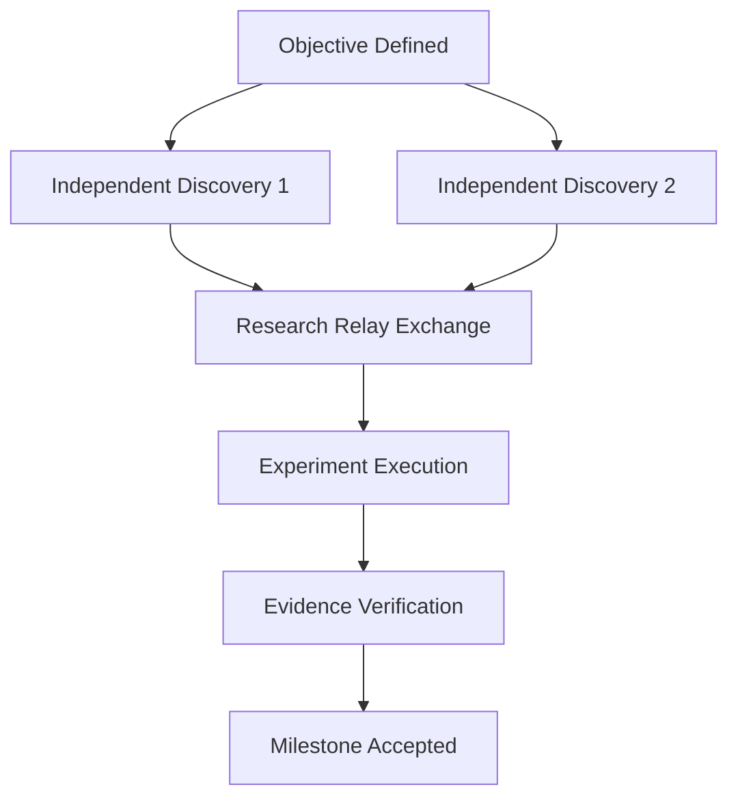

# Prioritized Research Task Graph & Next Actions

## Acyclic Task Graph

## Prioritized Task Backlog

| Priority | Task ID | Description | Role / Assignee | Prerequisite Tasks | Target Metric / Artifact | Status |
|----------|---------|-------------|-----------------|--------------------|--------------------------|--------|
| P0       | T_001   |             |                 |                    |                          | TODO   |
