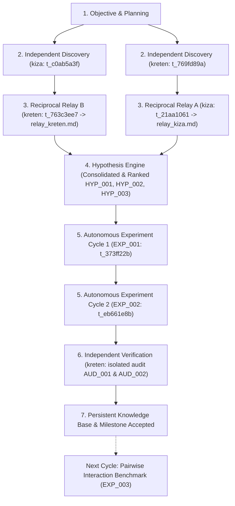

# Prioritized Research Task Graph & Next Actions

## Acyclic Task Graph (Autonomous Research Engine)

## Prioritized Task Backlog

| Priority | Task ID | Description | Role / Assignee | Prerequisite Tasks | Target Metric / Artifact | Status |
|----------|---------|-------------|-----------------|--------------------|--------------------------|--------|
| P0       | `t_c0ab5a3f` | [Relay-1A] Independent Discovery: OOF formulation | `kiza` (Researcher) | None | `research/discoveries/kiza_discoveries.md` | ✅ DONE |
| P0       | `t_769fd89a` | [Relay-1B] Independent Discovery: Regularization methods | `kreten` (Researcher) | None | `research/discoveries/kreten_discoveries.md` | ✅ DONE |
| P0       | `t_763c3ee7` | [Relay-2] Reciprocal Relay: kreten extends kiza | `kreten` (Relay Agent) | `t_c0ab5a3f` | `research/discoveries/relay_kreten.md` | ✅ DONE |
| P0       | `t_21aa1061` | [Relay-Reciprocal-A] Reciprocal Relay: kiza extends kreten | `kiza` (Relay Agent) | `t_769fd89a` | `research/discoveries/relay_kiza.md` | ✅ DONE |
| P0       | `t_373ff22b` | [Relay-3] Experiment Cycle 1: 5-Fold CV benchmark (EXP_001) | `kiza` (Experimenter) | `t_763c3ee7` | `oof_predictions.pkl`, AUC=0.6981 | ✅ DONE |
| P0       | `t_eb661e8b` | [Experiment-Cycle-2] Experiment Cycle 2: M-Estimate Grid Sensitivity (EXP_002) | `kiza` (Experimenter) | `t_21aa1061` | `oof_predictions_exp002.pkl`, AUC=0.69815 | ✅ DONE |
| P0       | `t_verif_02` | [Verification] Independent Audit of EXP_001 & EXP_002 in isolated context | `kreten` (Verifier) | `t_eb661e8b` | `verification/evidence.md` (AUD_002) | READY |
| P1       | `t_exp_003` | [Experiment-Cycle-3] Evaluate GBDT (LightGBM) with regularized OOF features vs Raw | `kiza` (Experimenter) | `t_verif_02` | Model performance comparison | QUEUED |
