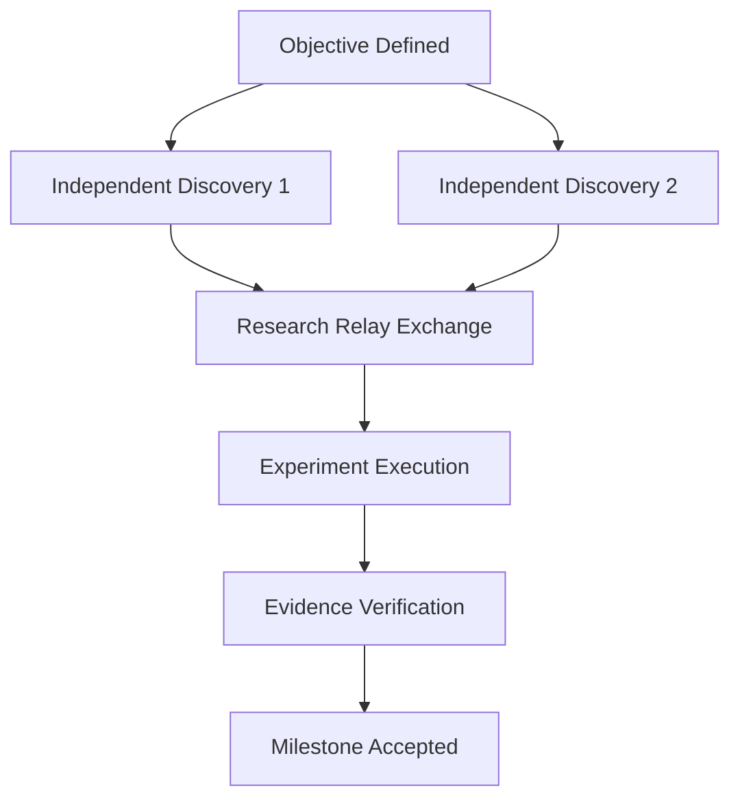

# Prioritized Research Task Graph & Next Actions

## Acyclic Task Graph

## Prioritized Task Backlog

| Priority | Task ID | Description | Role / Assignee | Prerequisite Tasks | Target Metric / Artifact | Status |
|----------|---------|-------------|-----------------|--------------------|--------------------------|--------|
| P0       | `t_c0ab5a3f` | [Relay-1A] Independent Discovery: OOF formulation | `kiza` (Researcher) | None | `research/discoveries/kiza_discoveries.md` | ✅ DONE |
| P0       | `t_769fd89a` | [Relay-1B] Independent Discovery: Regularization methods | `kreten` (Researcher) | None | `research/discoveries/kreten_discoveries.md` | ✅ DONE |
| P0       | `t_763c3ee7` | [Relay-2] Research Relay: Peer extension & synthesis | `kreten` (Relay Agent) | `t_c0ab5a3f`, `t_769fd89a` | `research/hypotheses.md` (HYP_001) | ✅ DONE |
| P0       | `t_373ff22b` | [Relay-3] Experiment Execution: 5-Fold CV benchmark | `kiza` (Experimenter) | `t_763c3ee7` | `oof_predictions.pkl`, `experiment_log.md` | ✅ DONE |
| P0       | `t_9a21f71f` | [Relay-4] Evidence Verification: Independent audit | `kreten` (Verifier) | `t_373ff22b` | `verification/evidence.md` (PASS) | ✅ DONE |
| P1       | `t_next_01` | Continuous Improvement: Grid search $m \in \{1, 5, 10, 20, 50\}$ for M-OOF | `kiza` (Experimenter) | `t_9a21f71f` | Hyperparameter sensitivity curve | READY |
| P1       | `t_next_02` | Continuous Improvement: Evaluate GBDT (LightGBM) with regularized OOF features | `kreten` (Experimenter) | `t_next_01` | Tree-based benchmark log | QUEUED |
