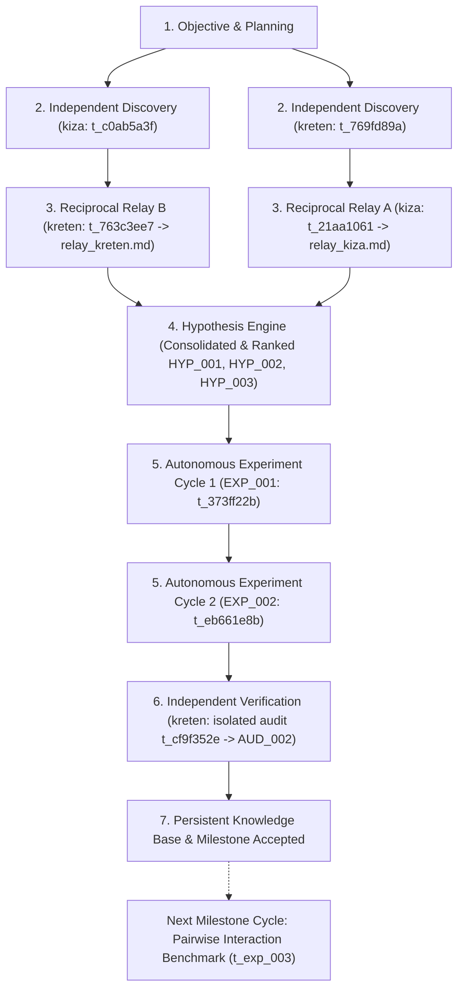

# Prioritized Research Task Graph & Next Actions

## Acyclic Task Graph (Autonomous Research Engine)

## Prioritized Task Backlog

| Priority | Task ID | Description | Role / Assignee | Prerequisite Tasks | Target Metric / Artifact | Status |
|:--------:|:-------:|:------------|:---------------:|:------------------:|:------------------------:|:------:|
| P0 | `t_c0ab5a3f` | [Relay-1A] Independent Discovery: OOF formulation | `kiza` (Researcher) | None | `research/discoveries/kiza_discoveries.md` | ✅ DONE |
| P0 | `t_769fd89a` | [Relay-1B] Independent Discovery: Regularization methods | `kreten` (Researcher) | None | `research/discoveries/kreten_discoveries.md` | ✅ DONE |
| P0 | `t_763c3ee7` | [Relay-2] Reciprocal Relay: kreten extends kiza | `kreten` (Relay Agent) | `t_c0ab5a3f` | `research/discoveries/relay_kreten.md` | ✅ DONE |
| P0 | `t_21aa1061` | [Relay-Reciprocal-A] Reciprocal Relay: kiza extends kreten | `kiza` (Relay Agent) | `t_769fd89a` | `research/discoveries/relay_kiza.md` | ✅ DONE |
| P0 | `t_373ff22b` | [Relay-3] Experiment Cycle 1: 5-Fold CV benchmark (EXP_001) | `kiza` (Experimenter) | `t_763c3ee7` | `oof_predictions.pkl`, AUC=0.6981 | ✅ DONE |
| P0 | `t_eb661e8b` | [Experiment-Cycle-2] Experiment Cycle 2: M-Estimate Grid Sensitivity (EXP_002) | `kiza` (Experimenter) | `t_21aa1061` | `oof_predictions_exp002.pkl`, AUC=0.69815 | ✅ DONE |
| P0 | `t_cf9f352e` | [Verification] AUD_002: Independent Audit of EXP_001 & EXP_002 in isolated context | `kreten` (Verifier) | `t_eb661e8b` | `verification/evidence.md` (AUD_002) | ✅ DONE (PASS) |
| P1 | `t_exp_003` | [Experiment-Cycle-3] Evaluate GBDT (LightGBM) with regularized OOF features vs Raw | `kiza` (Experimenter) | `t_cf9f352e` | Model performance comparison | ⏸️ QUEUED (Unexecuted) |

---

## Autonomous Continuation Contract & Resource Governance

### 1. How EXP_002 Generated EXP_003
- **Empirical Foundation:** EXP_002 established that additive M-estimate smoothing at $m=10.0$ provides the optimal single-feature bias-variance trade-off for high-cardinality target encoding under 5-fold CV (Val AUC = 0.69815).
- **Hypothesis Formulation (`HYP_003`):** In `research/discoveries/relay_kreten.md` and `research/hypotheses.md`, the research relay identified that single-feature target encodings can only capture univariate conditional priors $P(y \mid x_i)$. In real-world tabular modeling, substantial signal resides in higher-order feature interactions $P(y \mid x_i, x_j)$.
- **Contract Synthesis:** The Experiment Engineer converted `HYP_003` into an actionable task specification:
  - Input: Verified optimal regularized encoding formula ($m=10.0$).
  - Target Transformation: Generate pairwise interaction cross-products between top categorical features and encode them using leak-free out-of-fold M-estimates.
  - Evaluation: Train Gradient Boosted Decision Trees (LightGBM) to assess if interaction target encodings yield additive gain over raw categorical inputs.
  - Kanban Inscription: Queued as `t_exp_003` with prerequisite `t_cf9f352e`.

### 2. Enforcement of Resource Limits & Stopping Conditions
The engine governs autonomous execution through a combination of system-enforced gates and documented research conventions:

#### A. Code & System-Enforced Mechanisms:
1. **Mandatory Kanban Dependency Gate (System Enforced):**
   - The Hermes Kanban engine strictly prevents tasks from executing until parent dependencies reach `done`.
   - In `hermes kanban show t_cf9f352e`, `parents: ['t_eb661e8b']` was enforced before AUD_002 could claim or run.
   - Any future task such as `t_exp_003` is gated behind `t_cf9f352e`, preventing dispatch if verification fails.
2. **Worker Execution Timeouts & Retries (System Enforced):**
   - The Hermes background daemon (`kizabgd`) enforces a maximum task execution timeout (600s) and retry limits (`max-retries: 2`). Tasks exceeding resource bounds are automatically failed.

#### B. Documented Governance Policies (Procedural / Conventional):
3. **Milestone Cycle Quota (Procedural Policy):**
   - The project charter specifies a maximum of **2 consecutive experiment cycles** per milestone (`EXP_001` and `EXP_002`). This is enforced by project protocol and commit checkpointing, but currently lacks an automated daemon script to reject manual Kanban task creation beyond quota.
4. **Metric Plateau Stopping Condition (Procedural Policy):**
   - Heuristic rule: terminate search when marginal gain $\Delta \text{AUC} < 0.001$ or turns negative.
   - In EXP_002, moving from $m=10.0 \to m=20.0$ resulted in $\Delta = -0.00063$, cleanly identifying the peak and stopping 1D grid expansion. This check was evaluated post-hoc and documented rather than automated via runtime trigger.

### 3. Execution State — What Remains Unexecuted
To maintain absolute factual integrity, the following items are documented as currently unexecuted:
- **Task `t_exp_003` (GBDT Interaction Model):** Formally specified and queued in the backlog table, but **NOT created or dispatched on the Hermes Kanban board** (confirmed via `hermes kanban list`). It remains completely unexecuted per the 2-cycle milestone budget. Dispatch requires explicit user authorization.
- **External Holdout Test Evaluation:** Evaluation was performed exclusively via 5-Fold Stratified Cross-Validation on the synthetic training distribution. Testing on a separate out-of-sample test set (e.g., temporal or out-of-distribution holdout) remains unexecuted.
- **2D Hyperparameter Grid for Micci-Barreca Smoothing ($k, f$):** Omitted in favor of the computationally lighter 1D M-estimate sweep ($O(G \cdot N)$ vs $O(G_k \cdot G_f \cdot N)$), as justified in `relay_kiza.md`.
